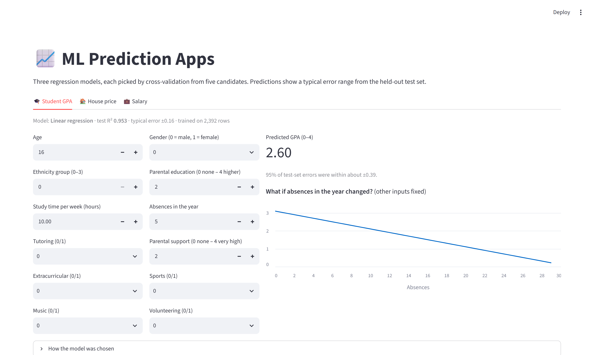
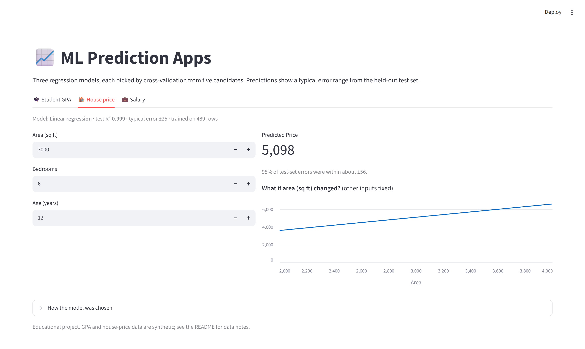
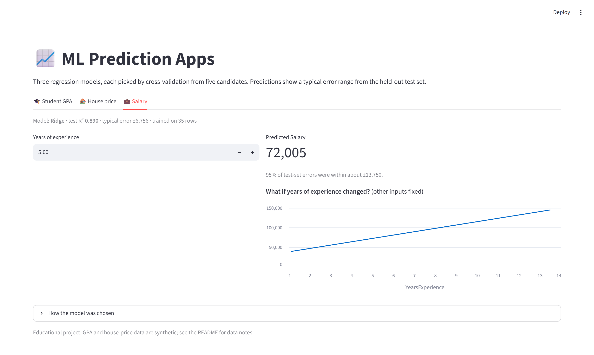
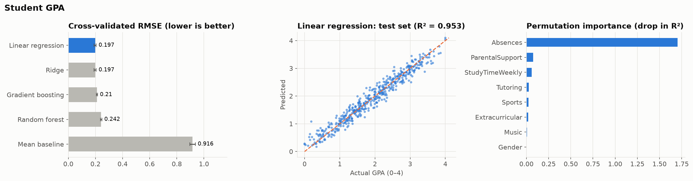

# ML Prediction Apps: GPA, house price and salary


Three regression problems, one workflow: compare five models with cross-validation, keep the best, check it on a held-out test set, explain what drives it, and serve it in a Streamlit app with error ranges and an out-of-range warning.



| House price tab | Salary tab |
|---|---|
|  |  |

## Results (held-out 20% test set)

| Task | Rows | Best model (by CV) | Test R² | Typical error (MAE) | vs mean baseline |
|---|---:|---|---:|---:|---|
| 🎓 Student GPA (0–4) | 2,392 | Linear regression | **0.953** | ±0.16 GPA | RMSE 0.197 vs 0.916 |
| 🏠 House price | 489 | Linear regression | **0.999** | ±25 | RMSE 29 vs 1,011 |
| 💼 Salary from experience | 35 | Ridge | **0.890** | ±6,756 | RMSE 7,511 vs 26,590 |

Candidates for every task: mean baseline, linear regression, ridge, random forest and gradient boosting. Full tables: [`reports/model_comparison.md`](reports/model_comparison.md).



### What the models learned

- **GPA is almost entirely about absences.** Each extra absence costs about **0.10 GPA points**, and absences alone explain **85%** of the variance on the test set (correlation −0.92). Tutoring (+0.26), extracurriculars (+0.19), sports (+0.19), music (+0.15) and parental support (+0.15 per level) add smaller effects.
- **House price is an almost exact linear formula:** about +1.50 per sq ft, +199 per bedroom and −50 per year of age. With R² = 0.999, the data is clearly generated.
- **Salary rises by about 8,500 per year of experience.** With only 35 points, the test error swings a lot from split to split (CV RMSE ± 1,300).
- **Linear models beat the tree ensembles on all three tasks.** The relationships are linear, and trees can only approximate a straight line with steps.

## Data checks that changed the results

**House prices: two datasets in one file.** The first 11 rows are a small hand-made teaching table (one missing bedroom count had been filled in as 5.5), pasted on top of 489 generated rows that follow a different price rule. Those 11 rows caused every large error:

| | Test RMSE | Test R² |
|---|---|---|
| All 500 rows | 245 | 0.932 |
| 489 consistent rows | **28.5** | **0.999** |

The raw file is kept unchanged; `ml_apps/tasks.py` skips the 11 rows and the reason is documented there.

**GPA: no leakage, but a contradictory label.** `GradeClass` is derived from GPA, so it is excluded from the features (using it would leak the answer). It's also inconsistent with GPA in this dataset: students labelled grade class 0 ("A") have GPAs anywhere from 0.21 to 4.0.

## The app

```bash
streamlit run app/streamlit_app.py
```

Each tab has:
- inputs for every feature, with a live prediction;
- a ±95% error band, from the model's errors on the test set;
- a **warning** when an input is outside the training data (the model is extrapolating);
- a **what-if chart** for the most important feature;
- the model comparison table and figures.

## Project structure

```
├── ml_apps/
│   ├── tasks.py       # Datasets, features, app input ranges, data fixes
│   └── train.py       # Model comparison, permutation importance, figures -> models/, reports/
├── app/streamlit_app.py
├── data/              # Raw CSVs (unchanged)
├── models/            # Best model per task + metadata (joblib)
├── reports/           # metrics.json, model_comparison.md, figures/
├── notebooks/         # Original classroom notebooks
└── tests/
```

## Quickstart

```bash
git clone https://github.com/arslanahmedbhutto/ml-prediction-apps.git
cd ml-prediction-apps
python -m venv .venv
source .venv/bin/activate          # Windows: .venv\Scripts\activate
pip install -r requirements.txt
python -m ml_apps.train            # ~1 min: retrain and rewrite reports
streamlit run app/streamlit_app.py
pytest
```

## Data

- Student GPA: [Students Performance Dataset](https://www.kaggle.com/datasets/rabieelkharoua/students-performance-dataset) (Kaggle, synthetic)
- Salary vs experience: classic teaching dataset (35 rows)
- House prices: course teaching dataset (generated)

## Related

[breast-cancer-classification](https://github.com/arslanahmedbhutto/breast-cancer-classification) (classification + FastAPI) · [data-analysis-portfolio](https://github.com/arslanahmedbhutto/data-analysis-portfolio)
